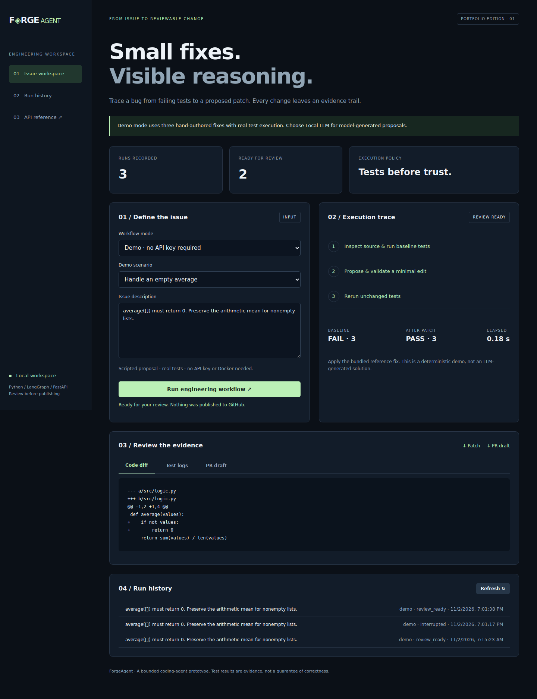

# ForgeAgent — AI Software Engineering Agent

A local Python issue-to-patch workbench with a FastAPI dashboard, LangGraph workflow, test evidence, and explicitly requested GitHub draft pull requests. No AWS account required.

**Start with the free deterministic demo.** It fixes three bundled Python bugs using scripted proposals and actually executes the tests before and after each fix. It does not call an LLM. Optional real mode asks an Ollama model to propose changes to a small Python repository and tests those changes in Docker.



## Windows: start here

1. Clone this repository or use **Code → Download ZIP** on GitHub, extract the archive, and open the `forge-agent` folder.
2. Double-click `setup_windows.bat`. This uses Python **3.12** and installs dependencies. Internet is needed once for package installation.
3. When it says **Setup complete**, double-click `START_FORGEAGENT.bat`.
4. Keep the terminal open. Once it says **Application startup complete**, open **http://127.0.0.1:8001**.
5. Choose **Handle an empty average**, then click **Run engineering workflow**. Review the failing baseline, passing verification, patch, and draft description.
6. Try the other two cases. Double-click `TEST_PROJECT.bat` to run the project tests.

Python 3.12 already installed for InspectAI can be reused. ForgeAgent creates its own `.venv-forge`; it does not modify InspectAI. No API key, Docker, or model download is needed for the demo. No C++ coding is required.

## Features and scope

| Capability | Implementation |
|---|---|
| Workflow | LangGraph: inspect → propose → verify |
| Baseline | Must discover tests and reproduce a failure before proposing a fix |
| Real model | Ollama JSON response with complete replacements for existing source modules |
| Policy | Up to 100 Python files / 200 KB; at most 5 edited source modules; tests are immutable |
| Execution | Trusted demo subprocess; Docker required for real repository code |
| Review | Unified diff, logs, trace, original snapshot, JSON export and PR draft |
| Storage | SQLite default; PostgreSQL through SQLAlchemy and optional Compose |
| GitHub | Read issue/default-branch snapshot; separate command creates a branch and draft PR |
| Interface | Responsive dashboard, local API documentation and CLI |

Supported real repositories have **standard-library-only Python code in `src/` and unittest tests in `tests/test*.py`**, importing from `src`. Existing source files can be changed; new files, test edits, dependency changes, binaries, symlinks, and arbitrary shell commands are not supported. This is a deliberately bounded portfolio project, not a general-purpose autonomous production engineer.

## Command line

Run commands in the project folder. On Windows:

```bat
.venv-forge\Scripts\python.exe -m forge.cli demo --case average
.venv-forge\Scripts\python.exe -m forge.cli demo --case discount
.venv-forge\Scripts\python.exe -m forge.cli demo --case unique
.venv-forge\Scripts\python.exe -m pytest -q
```

CLI runs export `changes.patch`, `PULL_REQUEST.md`, and `run.json` under `runtime/exports/<run-id>/`. The source repository is never modified by a run. Use `python -m forge.cli export RUN_ID` to export a dashboard run. On macOS/Linux, run `sh start.sh` with Python 3.12 installed, then use `.venv-forge/bin/python` for CLI commands.

## Real AI mode and GitHub

See [REAL_AI_SETUP.md](docs/REAL_AI_SETUP.md) for exact Windows commands, model setup, Docker runner and draft PR publishing. Review the patch before publishing. There is no automatic merge or push to the default branch.

## What the demo proves (and what it does not)

The no-cost demo uses **scripted fixes**, not LLM-generated code. It genuinely runs tests on three bundled examples, displays before/after evidence and produces review artifacts. A passing scripted demo does **not** prove that an Ollama model can solve unseen GitHub issues or that remote draft PR publication has been exercised.

Real AI mode requires a locally running Ollama model and Docker for untrusted code execution. GitHub publishing additionally requires an authorized GitHub token and an explicit separate publishing command; it never auto-merges. Do not describe the project as a fully autonomous or production-ready coding agent.

## Validation

See [verification.md](reports/verification.md), [tests.txt](reports/tests.txt), and [demo_evaluation.json](reports/demo_evaluation.json). Demo results measure the bundled scripted cases only; they are not LLM benchmark scores. Live Ollama, Docker execution, PostgreSQL and remote PR publishing must be checked in your own environment; their integration contracts are covered with mocks where stated in the report.

## Project map

- `forge/`: API, workflow, model adapter, policy, executor, storage, GitHub and CLI.
- `web/`: dashboard HTML, CSS and JavaScript, no frontend build required.
- `tests/`: workflow, policy, timeout, API and mocked integration tests.
- `examples/mini_repo/`: intentionally buggy standard-library example for real mode.
- `docs/`: setup, architecture, interview guide, security boundaries and troubleshooting.
- `reports/`: reproducible demo evaluation, test results and UI screenshots.

## Configuration

| Variable | Default / purpose |
|---|---|
| `DATABASE_URL` | `sqlite:///runtime/forge.db` |
| `OLLAMA_MODEL` | Required only for real mode; installed model tag |
| `OLLAMA_URL` | `http://127.0.0.1:11434` |
| `FORGE_REPO_PATH` | Enables real mode in dashboard; absolute local repository path |
| `FORGE_RUNNER_IMAGE` | `forge-runner:1`; build before real runs |
| `GITHUB_TOKEN` | Optional for public reads; required to publish |

`.env` is read by Docker Compose only. Set environment variables in the command prompt that launches the Python process. The dashboard is intended for your own computer: keep it bound to 127.0.0.1. It has no multi-user authentication.

## Docker and PostgreSQL (optional)

```sh
docker compose up --build
```

Open http://127.0.0.1:8001. This Compose deployment runs the **demo** with PostgreSQL, retaining data in a named volume. Change the local example database password via `.env.example` → `.env`. PostgreSQL has no host port. Stop with `docker compose down`; the volume remains. Run real mode from the host CLI, where Docker and Ollama are available. The dashboard container deliberately has no Docker socket mounted.

## License and dependencies

Project source is MIT licensed. Third-party packages retain their own licenses. `requirements.txt` pins direct dependencies; `requirements-lock.txt` records the full development environment used for validation. Dependencies and model weights are downloaded separately and are not bundled in this ZIP. No paid API service or cloud deployment is configured.
